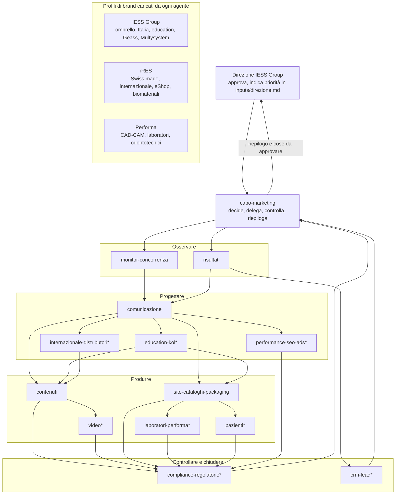

# Team di agenti e stack strumenti

## 1. Bastano sei agenti? Valutazione e consiglio

**Sì per partire, no per un team "solido" a regime.** I sei agenti attuali coprono il ciclo base (decidere, osservare, comunicare, produrre, misurare, sito/cataloghi/packaging) e sono facili da governare. Nel dentale, però, ci sono quattro leve che pesano quanto i social e oggi sono "spalmate" dentro agenti generalisti: **education e KOL**, **distributori internazionali** (iRES vende in 25 Paesi), **compliance regolatoria** (dispositivi medici) e **performance** (SEO, ads, remarketing con dati reali). Un agente che fa troppe cose produce output medi.

Consiglio: **crescere per fasi fino a 10-12 agenti**, un solo capo, agenti per funzione (non per brand: i brand sono profili che ogni agente carica, vedi §2). Oltre 12 il costo di coordinamento supera il beneficio.

| Fase | Agente | Cosa fa | Perché serve | Brand principale |
|---|---|---|---|---|
| **1 (attivi)** | `capo-marketing` | decide priorità, delega, controlla, riepiloga | un solo punto di decisione | tutti |
| 1 | `monitor-concorrenza` | 75 concorrenti per tier e gruppo | intelligence settimanale | tutti |
| 1 | `comunicazione` | strategia, messaggi, piano editoriale, campagne, sponsorizzate | cosa dire a chi | tutti |
| 1 | `contenuti` | post, caroselli, script, newsletter, grafiche | produzione | tutti |
| 1 | `risultati` | interazioni, risposte, lead, KPI | misura e community | tutti |
| 1 | `sito-cataloghi-packaging` | sito/SEO, cataloghi, packaging | asset durevoli | tutti |
| **2 (consigliati subito)** | `compliance-regolatorio` | gate indipendente su claim, MDR art. 7, pubblicità al pubblico, GDPR, etichette/UDI; registro claim approvati | per un produttore di dispositivi medici il controllo non può stare solo nel capo: serve un "secondo paio di occhi" con regole proprie e un **registro dei claim approvati** riusabile da tutti | tutti |
| 2 | `education-kol` | calendario corsi, landing e DEM, relatori, recap, programma KOL, fiere e congressi (Expodental, IDS, AEEDC, SIdP, SIO, EAO), materiali stand | l'education è il principale motore di lead e fidelizzazione del gruppo; i KOL sono la prova scientifica | IESS, iRES |
| 2 | `internazionale-distributori` | contenuti EN/ES/DE/FR/PL, kit distributori (sell-in, listini, visual), newsletter EN, localizzazione dei post, supporto fiere estere, ascolto dei mercati | iRES è un brand internazionale: senza un agente dedicato i contenuti EN restano traduzioni dell'Italia | iRES |
| 2 | `performance-seo-ads` | SEO tecnico e keyword, Search Console, GA4, gestione proposta campagne Meta/LinkedIn/Google con dati reali, remarketing, test, CPL | separa il "cosa comunicare" (comunicazione) dal "come farlo rendere" (performance); lavora su numeri | tutti |
| **3 (a regime)** | `video` | script lunghi e brevi, storyboard, brief riprese, montaggio con Descript, voice-over ElevenLabs, sottotitoli, Shorts/Reels da corsi e interviste | YouTube e Reels sono il formato con più leva per casi clinici e KOL | IESS, iRES |
| 3 | `crm-lead` | qualifica e instradamento lead alla rete vendita, sequenze email post-corso e post-download, promozioni eShop ai clienti, riattivazione | chiude il cerchio tra marketing e vendite | iRES (eShop), IESS |
| 3 | `laboratori-performa` | contenuti per odontotecnici, tutorial CAD-CAM, librerie, tempi e servizi Performa, co-marketing con i laboratori | Performa parla a un pubblico diverso (laboratorio) con linguaggio e canali propri | Performa |
| 3 | `pazienti` | area paziente dei siti, FAQ, SEO informativa, materiali per lo studio (locandine, leaflet "chiedi al tuo dentista") | crea domanda verso gli studi clienti, nel rispetto del divieto di pubblicità al pubblico | IESS, iRES |

Cosa **non** aggiungere: un agente per brand (duplica il lavoro), un agente "social media manager" generico (già coperto da comunicazione + contenuti + risultati), un agente per ogni piattaforma.

## 2. Schema agenti per IESS Group, iRES e Performa

Principio: **agenti per funzione, brand come profilo.** Ogni agente, prima di lavorare, carica `brand/brand-brief.md` e il profilo del brand su cui opera (`brand/profili/iess.md`, `ires.md`, `performa.md`). Il capo assegna il brand in ogni delega.

`*` = agenti proposti (fase 2 e 3), non ancora creati. Versione grafica modificabile: `docs/schema-agenti.drawio` (apribile su app.diagrams.net).

### Matrice agenti × brand

| Agente | IESS Group (ombrello: Geass, Multysystem, education, Italia) | iRES (Swiss made, 25 Paesi, eShop, biomateriali, SmartGuide, FixLite) | Performa (CAD-CAM, laboratori) |
|---|---|---|---|
| capo-marketing | priorità di gruppo, budget, calendario education | priorità export, eShop, lanci Swiss made | priorità servizi lab, tempi, co-marketing |
| monitor-concorrenza | italiani tier 1, gruppi globali in Italia | svizzeri (Thommen, TRI, SGS, Implant Swiss, ROOTT, IML), Straumann/NUVO, value brand | centri di fresaggio, CAD-CAM (BEGO, Dentsply, exocad ecosystem) |
| comunicazione | LinkedIn istituzionale, Instagram/Facebook, newsletter IT | Instagram/Facebook iRES, LinkedIn pagina (da creare), newsletter EN distributori | LinkedIn + Instagram verso laboratori, newsletter odontotecnici |
| contenuti | casi clinici, corsi, backstage Pozzuolo e Lissone | prodotto Swiss made, Mendrisio, EN, eShop | tutorial digitali, before/after protesico, librerie |
| risultati | KPI gruppo, interazioni canali IESS | KPI iRES, eShop, distributori | lead laboratori |
| sito-cataloghi-packaging | iess.dental, geass.it, catalogo gruppo, packaging Geass/IESS | ires.dental (6 lingue), eShop, cataloghi multilingua, packaging iRES e biomateriali | performa.dental, listino servizi, modulistica |
| compliance-regolatorio* | claim Synthegra, ibrido, area paziente | claim per Paese, lingue etichette | claim materiali protesici |
| education-kol* | calendario corsi Italia, KOL board, Expodental | ImplantBook, board Simion, IDS, AEEDC, EuroPerio | corsi digitali per laboratori |
| internazionale-distributori* | – | kit distributori, newsletter EN, localizzazioni | – |
| performance-seo-ads* | SEO IT, ads corsi | SEO multilingua, ads eShop, remarketing distributori | SEO "centro di fresaggio" |
| video* | KOL, corsi, backstage | produzione Mendrisio, tutorial prodotto EN | workflow digitale |
| crm-lead* | lead corsi → agenti | lead eShop e distributori | lead laboratori |
| laboratori-performa* | – | – | tutto il piano Performa |
| pazienti* | area paziente iess.dental | pazienti.ires.dental | – |

## 3. Skill, plugin e connettori per lavorare al top

Legenda stato: **ok** = già disponibile in questa sessione; **collegare** = connettore esterno da autorizzare o configurare; **esterno** = strumento non Claude, i dati entrano via export o API.

### 3.1 Ricerca, monitoraggio e intelligence
| Strumento | Tipo | Serve a | Agente | Stato | Priorità |
|---|---|---|---|---|---|
| WebSearch / WebFetch | built-in | ricerca e lettura pagine | tutti | ok | 1 |
| Firecrawl (scrape, search, agent) | connettore MCP | lettura strutturata siti concorrenti, news, Ad Library, ricerca settimanale | monitor-concorrenza, sito | ok (non nelle sessioni pianificate) | 1 |
| Bright Data plugin (`brand-listening`, `competitive-intel`, `scrape`) | plugin + connettore | lettura Instagram/Facebook/LinkedIn dei concorrenti, menzioni del brand, prezzi | monitor-concorrenza, risultati | collegare (MCP non raggiungibile oggi: va autorizzato l'host) | 1 |
| `venture:competitors` + `venture:competitor-scout` | skill | profilo approfondito di un singolo concorrente | monitor-concorrenza | ok | 2 |
| `marketing:competitive-brief`, `product-management:competitive-brief` | skill | brief competitivo per la direzione | monitor-concorrenza, capo | ok | 2 |
| `social-media-skills:competitor-analysis`, `viral-reverse-engineering`, `trend-jacking` | skill | analisi social dei concorrenti e trend | monitor-concorrenza, comunicazione | ok | 2 |
| Google Alerts / Talkwalker Alerts | esterno | alert gratuiti su nomi concorrenti e brand | monitor-concorrenza | esterno | 2 |
| Meta Ad Library, LinkedIn Ads tab | esterno (pubblico) | inserzioni attive dei concorrenti | monitor-concorrenza | ok via fetch | 1 |

### 3.2 Strategia e comunicazione
| Strumento | Tipo | Serve a | Agente | Stato | Priorità |
|---|---|---|---|---|---|
| `marketing:campaign-plan`, `marketing:brand-review` | skill | piano campagna, verifica coerenza di brand | comunicazione, capo | ok | 1 |
| `social-media-skills:social-strategy`, `content-pillars`, `content-calendar`, `goals-and-kpis`, `audience-research`, `campaign-and-launch-planning` | skill | metodo per strategia, pilastri, calendario, KPI | comunicazione | ok | 1 |
| `brand-voice` plugin (`generate-guidelines`, `enforce-voice`, `discover-brand`) | plugin | generare e far rispettare le linee guida di voce da documenti e materiali esistenti | comunicazione, contenuti, capo | ok | 1 |
| `social-media-skills:linkedin-company-pages`, `instagram-growth`, `facebook-strategy`, `youtube-long-form`, `hashtag-strategy`, `instagram-seo`, `social-seo` | skill | tattiche per canale | comunicazione | ok | 2 |
| `small-business:content-strategy`, `marketing-monday`, `growth-pulse` | skill | routine settimanale leggera | capo | ok | 3 |
| Claude Docs / artifacts | connettore | documenti condivisi con la direzione (strategia, riepiloghi) | capo | ok | 2 |

### 3.3 Produzione contenuti
| Strumento | Tipo | Serve a | Agente | Stato | Priorità |
|---|---|---|---|---|---|
| `social-media-skills:caption-writer`, `carousel-writer`, `hook-writer`, `linkedin-post-writer`, `reels-script`, `short-form-video-script`, `story-writer`, `thread-writer`, `reply-and-comment-writer`, `email-and-newsletter`, `platform-specs-and-validation` | skill | scrittura per formato e canale, limiti tecnici | contenuti, risultati | ok | 1 |
| `marketing:content-creation`, `marketing:email-sequence` | skill | contenuti e sequenze email | contenuti, crm-lead | ok | 1 |
| `humanize-kit:humanize`, `humanize-ig` | skill | togliere il "suono da AI" ai testi | contenuti | ok | 2 |
| Canva (MCP + skill `canva:*`, `brand-check`, `resize-for-social-media`, `bulk-create`) | connettore + skill | grafiche da brand kit, ridimensionamento multi-canale, batch | contenuti | ok (autorizzare Canva Pro con brand kit IESS/iRES/Performa) | 1 |
| Adobe Express / Firefly (`adobe-for-creativity:*`, `create-social-variations`, `brand-kit`, `product-photo-cutout`, `resize-photos-and-videos`) | connettore + skill | varianti social, scontorno foto prodotto, PDF | contenuti, sito-cataloghi | ok | 2 |
| Figma (MCP + skill) | connettore | layout cataloghi, packaging, design system del gruppo | sito-cataloghi-packaging | ok | 2 |
| `image-generation`, Picsart Media Studio, ElevenLabs creative (immagini) | connettore/skill | sfondi e visual astratti (mai immagini cliniche generate) | contenuti | ok | 3 |
| Gamma | connettore | presentazioni per rete vendita e distributori, deck fiere | internazionale, education | ok | 2 |
| `anthropic-skills:pptx`, `docx`, `pdf`, `xlsx` | skill | documenti nativi (listini, argomentari, report) | tutti | ok | 2 |

### 3.4 Video e audio
| Strumento | Tipo | Serve a | Agente | Stato | Priorità |
|---|---|---|---|---|---|
| Descript (MCP + skill) | connettore | montaggio da trascrizione, clip social da registrazioni corsi, sottotitoli | video, contenuti | ok | 2 |
| ElevenLabs (speech, transcribe, dubbing) | connettore | voice-over multilingua, trascrizioni interviste KOL | video, internazionale | ok | 2 |
| HeyGen / HyperFrames, Synthesia skill | connettore/skill | video avatar per tutorial prodotto in più lingue | video, internazionale | ok | 3 |
| `social-media-skills:captions-and-clipping`, `youtube-publishing-and-metadata`, `youtube-shorts`, `thumbnail-design`, `talking-head-and-piece-to-camera`, `scripting-and-storyboarding` | skill | metodo video | video | ok | 2 |
| `remotion:*` | skill | video programmati (dati, animazioni) | video | ok | 3 |
| Opus Clip / CapCut (skill) | skill | clipping e montaggio rapido | video | ok | 3 |

### 3.5 Pubblicazione, programmazione e community
| Strumento | Tipo | Serve a | Agente | Stato | Priorità |
|---|---|---|---|---|---|
| **Postiz** (CLI + skill `postiz:postiz`) | esterno + skill | programmare post su Instagram, Facebook, LinkedIn Pages, YouTube, WordPress; leggere analytics e commenti | contenuti (pubblica), risultati | collegare (`npm i -g postiz`, `postiz auth:login`, account Postiz con i canali IESS/iRES/Performa) | **1** |
| Meta Business Suite | esterno | pubblicazione nativa, inbox, insight, export CSV | risultati | esterno (export settimanale) | 1 |
| LinkedIn Pages Analytics | esterno | export follower/aggiornamenti | risultati | esterno | 1 |
| YouTube Studio | esterno | analytics, commenti | risultati | esterno | 2 |
| `social-media-skills:community-management`, `engagement-routine`, `crisis-and-moderation`, `social-selling-and-dm` | skill | gestione interazioni e crisi | risultati | ok | 1 |
| Slack / Microsoft Teams (plugin `slack-by-salesforce`, connettore Microsoft 365) | connettore | notifiche del run settimanale e cose da approvare al team | capo | ok (M365) / collegare (Slack) | 2 |
| Gmail / Google Calendar | connettore | bozze email a relatori e distributori, calendario corsi condiviso | education-kol, internazionale | ok | 2 |

### 3.6 Email marketing e CRM
| Strumento | Tipo | Serve a | Agente | Stato | Priorità |
|---|---|---|---|---|---|
| Piattaforma newsletter (Brevo, Mailchimp o MailUp) | esterno | invio, segmenti, automazioni, export | contenuti, crm-lead | collegare (indicare quale) | 1 |
| CRM (HubSpot, Zoho o gestionale interno) | esterno | lead → agenti, storico clienti, corsi | crm-lead, risultati | collegare | 2 |
| eShop iRES (piattaforma da indicare) | esterno | vendite, carrelli abbandonati, promozioni clienti | crm-lead, performance | collegare | 2 |
| `sales:draft-outreach`, `sales:lead-triage`, `small-business:speed-to-lead`, `reactivate`, `outreach-composer` | skill | qualifica e risposta ai lead, riattivazione | crm-lead | ok | 2 |
| `twilio-sendgrid-*` o Robotomail skill | skill | invio email transazionali/sequenze se serve un canale proprio | crm-lead | ok | 3 |

### 3.7 Sito, SEO e performance
| Strumento | Tipo | Serve a | Agente | Stato | Priorità |
|---|---|---|---|---|---|
| `searchfit-seo` plugin (`seo-audit`, `keyword-clustering`, `content-brief`, `on-page-seo`, `technical-seo`, `schema-markup`, `internal-linking`, `content-translation`, `ai-visibility`) | plugin | audit, keyword, brief, schema, hreflang, traduzioni SEO | sito, performance | ok | 1 |
| `marketing:seo-audit`, `small-business:seo-ai-visibility` | skill | audit rapido e visibilità nelle risposte AI | sito | ok | 2 |
| Google Search Console, GA4 | esterno | query, posizioni, traffico, conversioni (export CSV o API) | performance, risultati | collegare | 1 |
| WordPress (iess.dental, ires.dental, geass.it) | esterno | pubblicazione articoli via Postiz (integrazione WordPress) o REST API | sito | collegare | 2 |
| Meta Ads, LinkedIn Campaign Manager, Google Ads | esterno | campagne, pixel/tag, pubblici di remarketing, export | performance | collegare (account, pixel, Insight Tag, consenso cookie) | 1 |
| `small-business:ad-manager`, `social-media-skills:experimentation-and-ab-testing`, `lead-magnets-and-funnels`, `link-in-bio-and-traffic` | skill | gestione ads e test | performance | ok | 2 |
| Semrush o Ahrefs | esterno | keyword, backlink, concorrenti SEO | performance, monitor-concorrenza | esterno (facoltativo) | 3 |
| `dataviz`, `data:*` skills | skill | grafici e analisi dei CSV per i report | risultati | ok | 2 |

### 3.8 Compliance e documenti
| Strumento | Tipo | Serve a | Agente | Stato | Priorità |
|---|---|---|---|---|---|
| `legal:compliance-check`, `legal:legal-risk-assessment` | skill | metodo di verifica su claim e pubblicità | compliance-regolatorio | ok | 1 |
| Registro claim approvati (`brand/claim-approvati.md`) | file interno | fonte unica dei claim ammessi, con riferimento bibliografico | tutti | da creare col regolatorio | 1 |
| Adobe Acrobat (MCP) / `pdf` skill | connettore | lettura IFU, cataloghi, confronto versioni | sito-cataloghi, compliance | ok | 2 |
| Google Drive / SharePoint | connettore | archivio materiali, liberatorie, consensi, foto | tutti | ok (Drive plugin, M365) | 1 |
| Docusign | connettore | liberatorie foto/video e consensi casi clinici firmati | contenuti, education | ok | 3 |

### 3.9 Orchestrazione
| Strumento | Tipo | Serve a | Stato | Priorità |
|---|---|---|---|---|
| Attività pianificata Claude Code (lunedì 07:02) | built-in | run settimanale automatico | ok (attiva) | 1 |
| GitHub (repo Marketing OS) | connettore | storico, approvazioni via `stato: approvato`, branch | ok | 1 |
| `loop` skill | built-in | monitoraggi ripetuti brevi (es. durante una fiera) | ok | 3 |
| `claude-memory:structured-memory`, `productivity:*` | skill | memoria tra sessioni di preferenze e decisioni | ok | 2 |

## 4. Roadmap di attivazione

| Settimana | Azione | Responsabile |
|---|---|---|
| 1 | Autorizzare Canva (brand kit), Firecrawl e Bright Data per le sessioni; indicare piattaforma newsletter, account ads, CRM in `brand/canali.md` | direzione / IT |
| 1 | Installare e autenticare Postiz con i canali IESS, iRES (e Performa), compilare `inputs/postiz-mappa.yaml` | marketing |
| 1 | Validare brand brief, profili di brand e compliance; creare `brand/claim-approvati.md` col regolatorio | direzione + regolatorio |
| 2 | Creare gli agenti di fase 2 (`compliance-regolatorio`, `education-kol`, `internazionale-distributori`, `performance-seo-ads`) | agenti su richiesta |
| 2 | Primo export GA4, Search Console, Meta, LinkedIn in `inputs/analytics/` per la baseline KPI | marketing |
| 3-4 | Pixel Meta, LinkedIn Insight Tag, GA4 con consenso cookie sui tre siti; pagina LinkedIn iRES; certificato TLS geass.it | web agency / IT |
| 5-8 | Fase 3 (`video`, `crm-lead`, `laboratori-performa`, `pazienti`) in base ai risultati dei primi report | capo + direzione |
